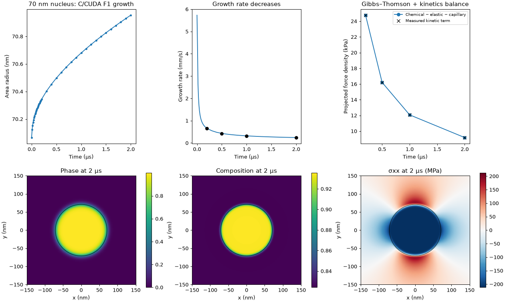
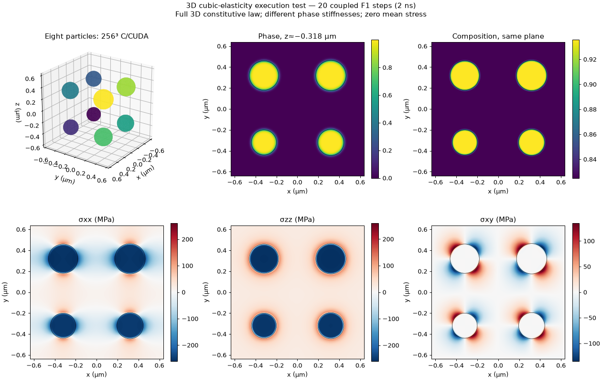

# Verified elasticity studies and run guide

Published on the `MicroSim-CUDA-2D-Inhom-F1` feature branch. The simulation modules
are C/CUDA (`KKS_FD_CUDA_MPI`) and CPU/MPI C++ (`KKS_CPU_MPI`, with a C interface).
Python supplies initialization, independent numerical checks and visualization.
The GPU studies below were executed on one RTX A3000, NVHPC 26.9/CUDA 12.9.

Start with the [CUDA README](../../KKS_FD_CUDA_MPI/README.md),
[CPU README](../../KKS_CPU_MPI/README.md), [changes](../../CHANGES.md), and
[detailed integration controls](../../KKS_FD_CUDA_MPI/INHOM_ELASTICITY_INTEGRATION.md).
The checked-in [result summaries](results/) contain numeric evidence; large
checkpoints, traces and evidence ZIPs are retained outside Git rather than
committed as oversized binaries.

## Dimensional law and loading

| Model | Constitutive content | Stress-free homogeneous strain |
|---|---|---|
| Generalized plane strain | 3D normal law; periodic ux,uy; uniform total Ezz; no xz/yz | Evaluate Exx,Eyy,Ezz,Exy from zero mean stress |
| Intrinsic 2D | xx,yy,xy only; no out-of-plane energy | Evaluate Exx,Eyy,Exy |
| Full 3D | Full cubic normal/shear law | Evaluate all six components |

Dimensional model and loading are separate choices. Stress-free means the mean
stress is zero and homogeneous strain is solved. Constrained means homogeneous
strain is prescribed. Prescribed nonzero mean stress also evaluates homogeneous
strain. Uniform total Ezz in generalized plane strain does **not** imply zero
local elastic epsilon_zz or zero local sigma_zz.

CUDA diagnostics and the CPU C API use tensor shear epsilon_xy. The Python
verification module's engineering shear gamma_xy is twice epsilon_xy. Elastic
forces are derivatives with respect to fractions; interpolation is chained once
by the coupled solver. The coherent elastic configurational force includes
traction work: with precipitate-minus-matrix jumps,
`g_el = [W_el] - t_nn[epsilon_nn] - t_nt[gamma_nt]`. A bare energy-density jump
is insufficient. The present model adds capillarity to the configurational
force; it does not introduce a separate mechanical surface-stress law.

## Critical nucleus: growth versus dissolution

The seeded 2D benchmark uses 512² cells, 1.25 nm spacing, a 640 nm periodic box,
0.008 initial matrix supersaturation, and a common initial chemical potential.
Matrix composition is 0.825 and precipitate composition is 0.9356. Gamma is
0.1 J/m², epsilon is 20 nm (approximately 15 nm 10–90% phase width), eigenstrain
is 0.001 in all normal components, and loading is stress-free generalized plane
strain. The two phases are individually isotropic but elastically different:
`CP=(450,150,150)` and `CM=(320,70,125)` GPa in C11,C12,C44 order.

At fixed initial chemical potential:

| Nominal initial radius | C/CUDA result |
|---|---|
| 50 nm | Shrinks at all sampled angles |
| 58.9 nm | Slowly shrinks |
| 59.048 nm | Nearly zero late **area** growth rate |
| 59.2049 nm | Slowly grows |
| 70 nm | Grows at all sampled angles |

The interpolated threshold is about **59 nm**. Separate 50–100, 100–150 and
150–200 ns windows put the crossing near 59.04–59.06 nm. The isolated sharp
isotropic-cylinder calculation gives 60.79 nm; finite volume fraction, evaluated
mean strain, finite interface width and discretization distinguish the periodic
calculation from that limit. The capillary-only estimate is 47.44 nm.
Consistently, the same 50 nm seed grows without elasticity but shrinks with it.

This is an unstable critical-size balance, not a stable final particle. A
near-zero area rate does not prove a stationary shape: residual angular motion
remains. These seeds have not been converged to a stationary critical saddle,
or extrapolated in grid/interface thickness. They are prescribed nuclei, not
spontaneous stochastic nucleation events. See [sweep data](results/critical_radius_sweep.json).

Reproduce individual radii by changing `--radius-nm` in
`tests/prepare_elasticity_case.py --case nucleus2d`. The default dt is 0.1 ns,
2000 steps, total 200 ns. Preparation only writes inputs; execute the resulting
case with the compiled C/CUDA program as shown in the module README.

## Longer 70 nm growth and elastic Gibbs–Thomson balance

The 70 nm case continued from 200 ns to 2 µs. The area radius
`sqrt(integral h(phi) dA/pi)` increased from **70.065 to 70.954 nm**. The final
instantaneous rate was **2.43e-4 m/s**. Mean composition drift stayed below
8.9e-16. A 20 ns overlap comparing dt=0.1 and 0.2 ns changed the radius increment
by 0.011%; this is a local timestep check, not full trajectory convergence.



At 2 µs the projected force densities are:

| Term | MPa |
|---|---:|
| Chemical drive | 1.824664 |
| Elastic resistance | 0.418587 |
| Diffuse capillary resistance | 1.396897 |
| Difference, accounted for by kinetics | 0.009180 |

The sharp cylindrical estimate gamma/R is 1.409363 MPa, about 0.9% above the
measured diffuse capillary contribution. The 2D curvature is 1/R, not 2/R.
The interface chemical potential was 19774.343 J/mol, compared with the exact
quadratic-F1 equilibrium Gibbs–Thomson reference 19773.511 J/mol. Its positive
kinetic excess is consistent with growth; an evolving interface should not be
forced to satisfy the equilibrium equality.

The scalar phase equation is
`phi_dot = L * (h'(phi)*(D_chem - dW_el/dh) - F_cap)`, with
`F_cap = 2*theta*phi*(1-phi)*(1-2*phi) - 2*kappa*laplacian(phi)`.
The check integrates this equation against `-dphi/dr`, normalizing by
`integral h'(phi)*(-dphi/dr)dr`. Native grid products are interpolated before
quadrature so the discrete chain rule is consistent. The kinetic term comes
from a separate one-step C/CUDA restart of each snapshot. The maximum angular
assembly residual is below 6e-7 Pa. This exact numerical identity checks coupling;
it is not independent proof of the sharp-interface limit.

Independent corrected Python mechanics checks at matching snapshots differed
from CUDA by less than 0.03 Pa in stress. No Python phase-field trajectory was
substituted for the nucleus growth. The same initial model is a closed periodic
cell, not an infinite reservoir, and the F1 parameters are synthetic rather than
calibrated alloy growth kinetics. See [summary](results/nucleus_2us_summary.json)
and [growth CSV](results/nucleus_2us_growth.csv).

## Full 3D cubic-elasticity execution and optimization

The 256³ benchmark has 16,777,216 cells in a 1.28 µm periodic cube, eight particles
with radii 120–155 nm, CP=(450,150,120) and CM=(320,70,85) GPa, isotropic diagonal
eigenstrain 0.001, and zero mean stress. Zener ratios are 0.8 and 0.68: these
are cubic **anisotropic** stiffnesses. The solver uses full 3D elasticity.



Twenty coupled steps at dt=0.1 ns cover **2 ns**. This checks large-volume
execution, conservation, mechanics and performance; it is not long 3D growth,
coarsening, faceting or scaling validation. The displayed 256³ stress plane is
exported directly from the C/CUDA solution; the 3D surface is decimated only
for rendering.

Two tested optimizations remove repeated three-volume displacement copies and
batch binary endian conversion/I/O by physical rows. Binary restart correctness
was also repaired, and bounded-memory z-slice export was added. The baseline for
timing already includes the binary-reader correctness fix; both versions use
the same binary input/output, precision, tolerance and physical parameters.

| Three-run median, 256³ / 20 steps | Seconds |
|---|---:|
| Baseline | 100.752 |
| Optimized | 94.777 |

This is **5.93% lower end-to-end wall time** (1.063x speedup), including startup,
solver, output and shutdown. Peak allocation stayed below 9 GiB on the 12 GiB GPU.
Phase/composition arrays, iteration counts and reported residuals are identical
to baseline. Small-grid startup variability means no universal speedup is claimed.
Nsight still identifies FFTs as the dominant steady-state work.

Independent 64³ FFTW-MPI C/C++ mechanics, called through its C API, differed from
CUDA by at most 0.94 Pa in stress, 1.26e-12 in strain and 0.0032 Pa in constrained
elastic force. CPU results were checked on 1 and 4 ranks. A separate two-step
3D local-update check (CPU force on step one, the next CUDA mechanical snapshot
on step two) differed by 4.4e-14 in phase and 1.1e-16 in composition.
See [physics](results/cubic_3d_physics.json), [timings](results/cubic_3d_timings.json)
and [performance summary](results/cubic_3d_performance.json).

## Validation boundaries

The earlier 20-check GPU 2D F1 suite passed again after optimization, including
anti-trapping, loading variants, temporal convergence and rejection of
unconverged mechanics. The CPU module has its separate 46-record acceptance
suite. The new binary I/O host test covers 2D/3D, F1/F2 field layouts, MPI ranks,
untouched halos, misleading binary payload bytes and truncation. F2 **I/O layout**
testing does not validate licensed F2 thermodynamics.

Only one physical GPU was available. CPU MPI rank agreement does not establish
multi-GPU CUDA scaling. Three-dimensional test grids had equal physical spacing;
unequal-spacing 3D finite-difference accuracy remains outside these checks.
Large production kinetics, long 3D growth, mesh/interface-thickness convergence,
licensed thermodynamic integration and multi-GPU validation remain outstanding.

## Reproduce the independent 3D mechanics comparison

Prepare a `cubic3d --grid 64 --steps 2 --save 1` case and set
`INHOM_DIAGNOSTICS = 1` in its input before running it. Build the fixed-reference
C caller with the CPU module's MPI/FFTW toolchain:

```bash
make -C KKS_CPU_MPI build/cuda_field_reference HDF5_PKG=hdf5-openmpi
python tests/compare_3d_cpu_cuda.py --grid 64 \
  --cuda-csv cubic64/elastic_rank0_step0.csv \
  --cpu-executable KKS_CPU_MPI/build/cuda_field_reference \
  --mpiexec 'mpiexec --oversubscribe' --ranks 4 --output comparison64
```

The C caller uses this benchmark's fixed stiffness/eigenstrain values and defaults
to spacing `1.28e-6/N`. This is not a general input-file converter. Its raw binary
slab files are temporary native-machine reference output; use the JSON comparison
for portable results. Repeat with one rank to check rank invariance. The comparison
requires a complete single-GPU volume CSV, not the bounded-memory slice output.
